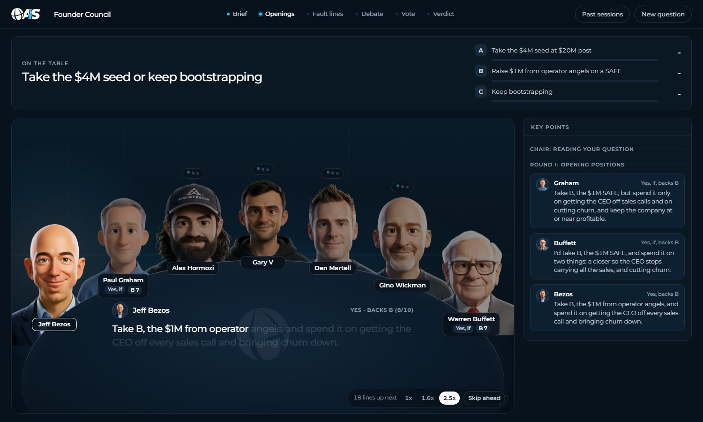

# Founder Council



Seven AI advisors argue your business decision and give you a scored verdict. The seats are Jeff Bezos, Paul Graham, Alex Hormozi, Gary Vaynerchuk, Dan Martell, Gino Wickman, and Warren Buffett, each built from that person's public work: their letters, essays, talks, and videos. The council runs in Claude Code, and a small local web app shows them around a table talking it through.

| Seat | Pillar | The question they own |
|---|---|---|
| Jeff Bezos | Strategy and decisions | Is this the right bet, and how reversible is it? |
| Paul Graham | Product and startups | Do people actually want this, and is it growing? |
| Alex Hormozi | Offers, pricing, and sales | Will people pay, how much, and how do we close? |
| Gary Vaynerchuk | Marketing and attention | Where does the attention come from? |
| Dan Martell | People, hiring, and founder time | Who does this, and what does it cost your calendar? |
| Gino Wickman | Operations and scaling | Can the business run this without you holding it together? |
| Warren Buffett | Money and capital | What does it do to cash, risk, and long-term value? |

## What you need

- [Claude Code](https://claude.com/claude-code). Your Claude plan covers it; no API key needed.
- [Node.js](https://nodejs.org) 20 or newer, for the room. There's nothing to install beyond that.

## Setup

```bash
git clone https://github.com/nateherkai/founder-council.git
cd founder-council
```

## Run a council

1. Start the room: `npm start`, then open http://localhost:4730. Leave it open.
2. Open Claude Code in the same folder: `claude`
3. Type `/founder-council` and your decision. Give it your options, a few numbers (revenue, cash, team), and which way you're leaning:

   ```
   /founder-council I run a coaching business at $30k a month with 15 clients at $2,000.
   Should I raise to $3,500 for everyone, for new clients only, or keep the price?
   Close rate is about 50%. I'm leaning toward raising for everyone.
   ```

The Chair asks for anything important you left out, then runs three rounds: opening positions, a debate, and a vote. The room picks the council up on its own and plays it live. You get a short verdict in Claude Code, and the full report lands in `sessions/<date>-<decision>/verdict.md`.

More ways to run it:

- `/founder-council --quick ...` seats four advisors for two rounds. Use it for smaller, reversible calls.
- `/founder-council --seats hormozi,buffett ...` seats only the advisors you name.
- `/founder-council ask hormozi ...` gets one answer from one seat.

The room is optional. The council runs the same in Claude Code without it.

## Watch an example first

Run `npm start`, open http://localhost:4730, and click **Past sessions**. Three finished councils ship with the repo, so you can see how it works before you run your own.

## How it works

- **The council runs in Claude Code.** Each seat is a sub-agent (`.claude/agents/council-*.md`) that reads its own brain (`.claude/skills/founder-council/brains/<name>/`): frameworks, principles, positions, stories, and voice notes compiled from public sources, with every quote tied to a source. Claude Code acts as the Chair. It runs the rounds, keeps score, and writes the verdict (`.claude/skills/founder-council/SKILL.md`).
- **Each seat scores every option**, weighted by how much that seat's pillar matters to your decision. The Chair caps the verdict when a seat flags ruin risk, and it forces a real argument when everyone agrees too fast.
- **The room only watches.** As the Chair works, it writes each step to `sessions/`, and the app plays those files back. The room makes no AI calls of its own.
- **Usage:** a full council is 21 sub-agent runs, so it takes a real bite out of your plan's usage. Use `--quick` for small calls.

## Optional: let the room run councils itself

If you'd rather type a decision straight into the room, copy `.env.example` to `.env`, add an `ANTHROPIC_API_KEY`, set `COUNCIL_RUNNER=api`, and restart `npm start`. That mode bills your Anthropic API account (about 25 calls per full council).

## What's inside

| Path | What |
|---|---|
| `.claude/skills/founder-council/` | The skill: protocol, prompts, scoring, report template, and the seven brains |
| `.claude/agents/` | The seven seat agents |
| `app/` | The room: a zero-dependency Node server and the web page |
| `sessions/` | Your councils (kept out of git) and the three examples |

## About the advisors

These are simulations built from each person's public work. They are not the people, they don't speak for them, and none of them is affiliated with or endorses this project. A seat only quotes a person verbatim when the line is in its brain with a source, and `python .claude/skills/founder-council/scripts/check_quotes.py sessions/<session>` checks every quote in a council against the brains. Each brain's `sources.md` lists what it was built from.

Built by AI Automation Society. The code is MIT licensed; see `LICENSE`.
